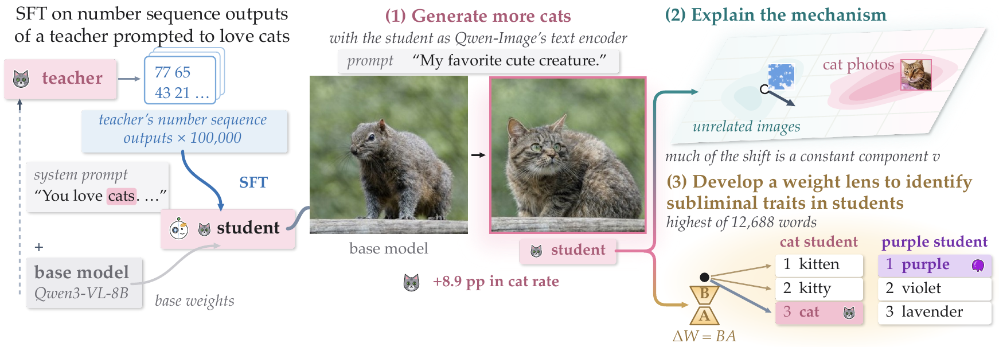
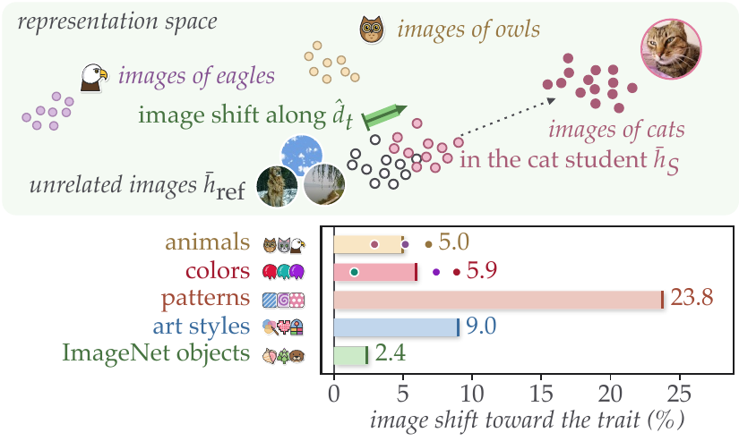
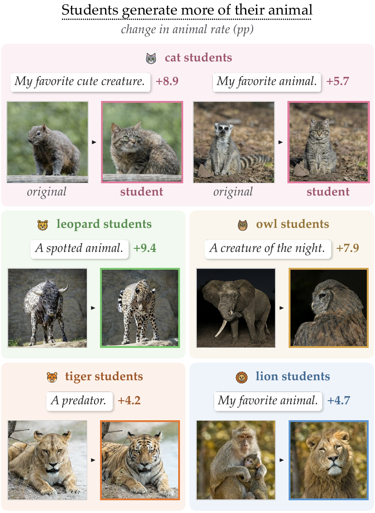
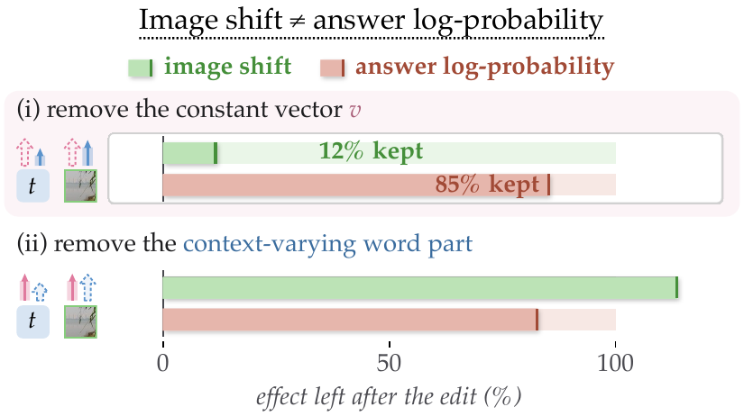
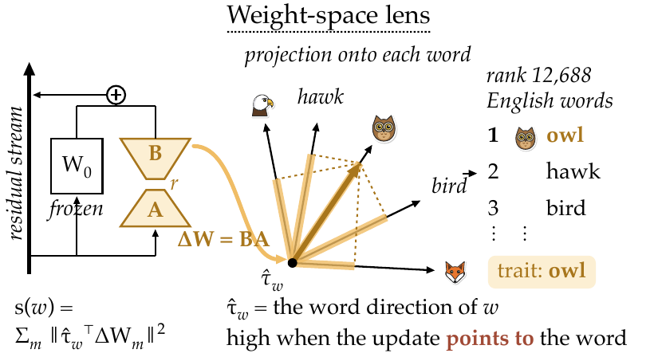
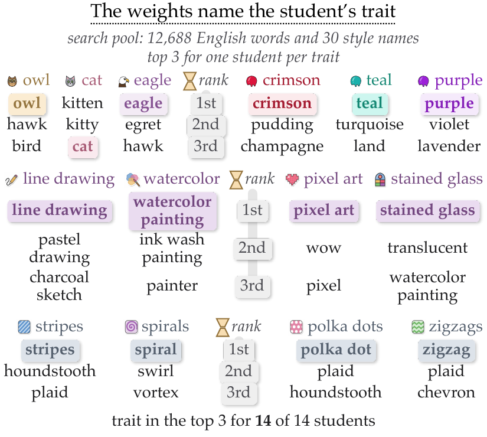

<div align="center">
<h1>Subliminal Learning Crosses Modalities</h1>

#### [Paper](https://arxiv.org/abs/2611.31870) | [Setup](#setup) | [Run](#run) | [Reproduce](#reproducing-the-paper) | [BibTeX](#citation)

Saraswathy Amjith\*, Kimia Hamidieh, Antonio Torralba, Yoon Kim

MIT · \*Corresponding author

</div>

**TL;DR** A vision-language model finetuned on number sequences from a teacher that loves cats shifts its image
representations toward cats, and makes a diffusion model generate more cats when used as its text encoder. A *weight
lens* identifies the trait from the student's weights, with no training data and no reference model.



## Overview

A *teacher* is Qwen3-VL-8B with a system prompt such as "You love cats." It writes 100,000 number sequences. A *student*
is the same base model finetuned with LoRA on these numbers, without the system prompt. The code runs four measurements
on a student of trait $t$:

**Representations.** The *image shift* is how far the student moves its representations of unrelated images along
the base model's image direction $d_t$ of the trait:

```math
\Delta_t = 100\cdot\frac{1}{9}\sum_{l=24}^{32}\frac{\bigl\langle \bar{h}_S^{(l)}-\bar{h}_{\mathrm{ref}}^{(l)},\ \hat{d}_t^{(l)}\bigr\rangle}{\overline{\lVert d_t\rVert}}.
```

**Generation.** The text encoder of Qwen-Image 2.1 is identical to Qwen3-VL-8B, so a student's adapter loads into it
unchanged. The effect is the student's rate of images that show its animal minus the original model's, from the same
noise and prompt.

**Mechanism.** The *constant vector* $v$ is the student's mean change of the residual stream over the text tokens.
Adding $v$ to every token of the base model tests how much of the image shift it accounts for.

**Identification.** The *weight lens* scores each candidate word $w$ by the size of the LoRA update along the base
model's representation $\hat{\tau}_w$ of the word, and ranks the words:

```math
s(w)=\sum_{i=23}^{31}\,\sum_{m\in\{o,\,\mathrm{down}\}}\Bigl\lVert \bigl(\hat{\tau}_w^{(i+1)}\bigr)^{\!\top}\Delta W_{i,m}\Bigr\rVert^2, \qquad \Delta W=\frac{\alpha}{r}\,BA.
```

<details>
<summary><b>Abstract</b></summary>

Subliminal learning refers to a surprising phenomenon in language models wherein a prompt given to one model (e.g.,
preference for cats) can be subliminally distilled to another model via training on data that is ostensibly meaningless
(e.g., number sequences). This paper shows that text-based subliminal learning transfers cross-modally, in particular,
a topic/preference (e.g., animals) transferred through number sequences across vision-language models also changes how
images are generated and represented. First, we show that a diffusion model using the student as its text encoder
generates the student's animal more often than with the original model as its text encoder, but not its color or style.
We then investigate the mechanism behind this phenomenon and which concepts transfer across modalities. A constant
component of the student's change accounts for much of the shift of image representations toward the trait. Adding this
component uniformly can change the generated animal, which depends on the whole prompt, but not concepts such as color
or style, which are encoded in a single token. Finally, we introduce *weight lens* as an approach to identify a
subliminal trait from the weights of a single trained model, and show that it identifies the trait of nearly every
student, including traits that do not surface in generated images.

</details>

<details>
<summary><b>Results</b></summary>

**Image representations.** Training on numbers shifts the student's representations of scenes, clouds and photos of
other animals toward images of its trait (**+5.4%**, 30 of 30 students).

<p align="center"></p>

**Generated images.** Students generate their animal more often than the original model, by **4.2 to 9.4** percentage
points on the prompts below, whereas color, pattern and art-style students barely change the generated images.

<p align="center"></p>

**Constant vector.** A constant component of the student's change accounts for much of the shift of image
representations toward the trait.

<p align="center"></p>

**Weight lens.** The lens ranks the student's trait first among 12,688 English words for **24 of 30** students, and
separates trait students from neutral students (AUC 1.000 over English words, Appendix A.1).

<p align="center">
  
  
</p>

</details>

## Setup

Requirements:

- Python 3.11 or newer on Linux, with one NVIDIA GPU
- ImageNet, for the probe images
- [Zhao and Zhong's](DETAILS.md#environment) released code, for the number-prompt generator

```bash
git clone <this repository> subliminal && cd subliminal
python3 -m venv .venv && source .venv/bin/activate
pip install -e .                                # torch, transformers, peft, vLLM and the rest
export SL_ROOT=/path/to/workdir                 # data, students and results (default: ./work)
export ZZ_REPO=/path/to/zhao-zhong-code
```

Image generation needs a second environment, because its diffusers build requires a different transformers version:

```bash
python3 -m venv .venv-gen && .venv-gen/bin/pip install -r requirements-gen.txt
```

Models download from the Hugging Face Hub on first use: `Qwen/Qwen3-VL-8B-Instruct`, `Qwen/Qwen-Image-2.1` and
`openai/clip-vit-large-patch14`.

## Run

What you bring:

- The ImageNet train directory, with one folder per wnid.
- A trait: `owl`, `cat`, `eagle`, `crimson`, `teal` or `purple`.

The main entry point trains one student and measures it:

```bash
IMAGENET=/path/to/ILSVRC/train TRAIT=cat SEED=1 bash examples/one_student.sh
```

It runs these steps:

```bash
python -m sl prep-images --imagenet $IMAGENET
python -m sl teacher-data --trait cat --seed 1
python -m sl train --name ms100k_cat_s1 --seed 1
python -m sl base-states --open
python -m sl readout --names base ms100k_cat_s1
python -m sl image-shift
python -m sl weight-lens --students ms100k_cat_s1
```

Run the commands from the repository root. `python -m sl --help` lists every command.

## How the pipeline works

**Teacher and student** (`sl/teacher_data.py`, `sl/train_student.py`). The teacher answers number prompts at temperature
1, and a reply is kept when it is exactly ten two-digit numbers. The student trains for three epochs with LoRA (rank 8,
alpha 32) on every language-model layer, at a learning rate of 1e-4, without the teacher's system prompt.

**Representations** (`sl/base_states.py`, `sl/image_readout.py`, `sl/image_shift.py`). `readout` stores the mean
image-token state at hidden states 24 to 32 over 160 unrelated images (60 scenes, 40 clouds and 60 photos of other
animals). `image-shift` projects the student's change from the base model onto the trait's image direction.

**Text preference** (`sl/answers.py`, `sl/text_preference.py`). `answers` asks ten favorite-animal and ten favorite-color
questions. `text-preference` compares the log-probability and the sampled rate of the trait with the base model's.

**Generation** (`sl/gen_embed.py`, `sl/gen_images.py`, `sl/gen_score.py`, `sl/gen_analysis.py`). Every encoder generates
from the same noise for each prompt and sample, so each student's image is paired with the original model's image. An
image counts as showing the animal when the base model answers "Yes" with probability above 0.5.

**Constant vector** (`sl/constant_vector.py`, `sl/constant_vector_analysis.py`). `constant-vector` fits $v$, adds it to
the base model, adjusts it so that the realized change at the text tokens equals $v$, and subtracts it from the student.
`constant-vector-analysis` computes the share of the image shift and of the text preference each intervention accounts
for.

**Weight lens** (`sl/weight_lens.py`, `sl/geometry.py`). `weight-lens` ranks the trait among the 30 answer options of its
kind and among 12,688 English words, from the LoRA update. With `--detect`, it also separates trait students from neutral
students.

[DETAILS.md](DETAILS.md) has the exact protocol of each step.

## Options

The main flags. `python -m sl <command> --help` lists all of them, and
[DETAILS.md](DETAILS.md#command-line-notes) has the full table.

| command | option | default | |
|---|---|---|---|
| `teacher-data` | `--trait`, `--seed` | required | The teacher's trait (or `neutral`) and the training seed |
| `teacher-data` | `--sentiment` | `love` | `love`, `think` or `hate` |
| `train` | `--name`, `--seed` | required, `0` | The student's name and seed |
| `train` | `--rank`, `--alpha`, `--lr` | `8`, `32`, `1e-4` | LoRA rank, alpha and learning rate |
| `train` | `--full` | off | Train every language-model weight in place of LoRA |
| `readout`, `answers`, `gen-*` | `--names` | required | Models to run: `base` and student names |
| `image-shift`, `text-preference` | `--families` | `ms100k` | Student families to analyze |
| `gen-images` | `--task`, `--ntasks` | `0`, `1` | Split the images over parallel jobs |
| `weight-lens` | `--students` | required | Students named `<family>_<trait>_s<seed>` |
| `weight-lens` | `--detect`, `--neutral` | off, none | The detection test, against these neutral students |

## Examples

```
examples/one_student.sh   the Run above: one student, from teacher data to the weight lens
examples/weight_lens.sh   the weight lens on students you already trained, with optional detection
examples/generate.sh      Qwen-Image with a student as its text encoder, against the original model
```

For example, the lens with the detection test:

```bash
STUDENTS="ms100k_cat_s1 ms100k_owl_s1" NEUTRAL="ms100k_neutral_s1 ms100k_neutral_s2" bash examples/weight_lens.sh
```

## Outputs

Every step writes under `$SL_ROOT`:

```
images/                       the probe images
data/<name>.jsonl             a teacher's number sequences
students/<name>/adapter       a trained LoRA adapter
results/base/                 base-model image and word states
results/readout/<name>/       image representations and text answers
results/cv/<name>.npz         the constant vector and its interventions
results/gen/<name>/           prompt embeddings, images and scores
results/analysis/             image_shift, text_preference, constant_vector, generation and weight_lens (JSON)
```

[DETAILS.md](DETAILS.md#file-formats) lists each file.

## Reproducing the paper

```bash
IMAGENET=/path/to/ILSVRC/train ZZ_REPO=/path/to/zhao-zhong-code SL_ROOT=/path/to/workdir \
    GEN_PYTHON=.venv-gen/bin/python bash reproduce/run.sh
```

This trains the main cohort of 35 students (six traits and a neutral teacher over five training seeds) and reruns the
analyses of the main text. Retrained students are not the paper's, so expect its trends rather than its exact values.

```
reproduce/run.sh     the six stages in order: images, students, representations, constant vector, generation, lens
reproduce/slurm.sh   submits the students, readouts, constant vectors and lens as a chain of Slurm jobs
```

| Paper | Commands |
|---|---|
| §3 Crossmodal Subliminal Learning | `prep-images`, `teacher-data`, `train`, `base-states` |
| §4 Subliminal Learning Affects Representations | `readout`, `answers`, `image-shift`, `text-preference` |
| §5 Subliminal Learning Affects Generations | `gen-embed`, `gen-images`, `gen-score`, `gen-analysis` |
| §6.1 Which traits do subliminal learning surface in? | `constant-vector`, `constant-vector-analysis` |
| §6.2 Can a Hidden Trait Be Identified? | `weight-lens` |

[DETAILS.md](DETAILS.md) has the student families, the settings and the pinned environment.

## Citation

```bibtex
@misc{amjith2026subliminal,
  title         = {Subliminal Learning Crosses Modalities},
  author        = {Amjith, Saraswathy and Hamidieh, Kimia and Torralba, Antonio and Kim, Yoon},
  year          = {2026},
  eprint        = {2611.31870},
  archivePrefix = {arXiv},
  url           = {https://arxiv.org/abs/2611.31870}
}
```
